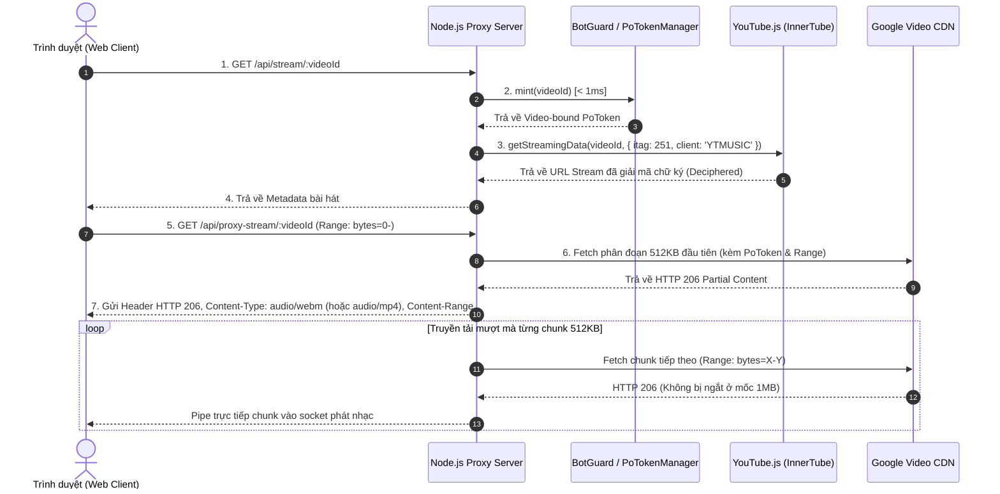

# 📝 Nhật ký Nâng cấp & Sửa lỗi — YT Stream Player

Tài liệu này ghi lại toàn bộ quá trình cập nhật thư viện lên phiên bản mới nhất, các lỗi phát sinh trong môi trường thực tế, nguyên nhân gốc rễ và giải pháp kỹ thuật đã triển khai.

---

## 📦 1. Danh sách thư viện đã nâng cấp

| Thư viện | Phiên bản cũ | Phiên bản mới | Mục đích & Thay đổi chính |
| :--- | :--- | :--- | :--- |
| **`youtubei.js`** | `github:LuanRT/YouTube.js` | **`^18.0.0`** | Bản phát hành chính thức mới nhất; hỗ trợ đầy đủ Node runtime, n-sig / signature deciphering. |
| **`bgutils-js`** | `^3.2.0` | **`^4.0.3`** | Nâng cấp kiến trúc BotGuard & PoToken mới (`BotGuardClient`, `getChallenge`, `WebPoMinter`). |
| **`express`** | `^5.1.0` | **`^5.2.1`** | Bản Express v5 mới nhất, tăng cường hiệu năng router. |
| **`jsdom`** | `^24.1.3` | **`^26.0.0`** | Hoạt động ổn định trên Node.js v22. |

---

## 🔍 2. Phân tích các lỗi & Nguyên nhân gốc rễ

### ❌ Lỗi 1: Module Export & Boundary Context trong `bgutils-js` v4
- **Hiện tượng**: `ERR_PACKAGE_PATH_NOT_EXPORTED` và `BgError: APF:Failed`.
- **Nguyên nhân**:
  1. `bgutils-js` v4 chia nhỏ submodule export (`bgutils-js/botguard`, `bgutils-js/utils`, `bgutils-js/webpo`).
  2. Phương thức `WebPoMinter.create` kiểm tra `mintCallback instanceof Function`, nhưng hàm callback được sinh ra bên trong realm của JSDOM window (`dom.window.Function.prototype`), dẫn đến `instanceof Function` của Node.js global bị `false`.
- **Giải pháp**:
  - Nhập trực tiếp các module:
    ```javascript
    import { BotGuardClient, getChallenge } from 'bgutils-js/botguard';
    import { buildURL, getHeaders, base64ToU8, u8ToBase64 } from 'bgutils-js/utils';
    ```
  - Trực tiếp kiểm tra và gọi minter callback qua `typeof mintCallback === 'function'`.

---

### ❌ Lỗi 2: Yêu cầu Evaluator trong `youtubei.js` 18.0.0
- **Hiện tượng**: `To decipher URLs, you must provide your own JavaScript evaluator`.
- **Nguyên nhân**: Trên Node.js, `youtubei.js` yêu cầu cung cấp hàm thực thi JS để giải mã chữ ký (signature decipher) và n-token của YouTube.
- **Giải pháp**:
  ```javascript
  Platform.shim.eval = async (data) => new Function(data.output)();
  ```
  Nhờ đó giải mã thành công toàn bộ stream URL từ các client `YTMUSIC`, `ANDROID_VR`, `WEB`.

---

### ❌ Lỗi 3: Lỗi Direct Stream (`NotSupportedError: Failed to load because no supported source was found`)
- **Hiện tượng**: Trình duyệt không thể phát âm thanh, báo lỗi nguồn phát không hỗ trợ.
- **Nguyên nhân**:
  1. Khi người dùng bật chế độ `Direct Stream`, trình duyệt nhận URL trực tiếp từ YouTube CDN (`googlevideo.com`). Google chặn 100% request từ origin trang web thứ 3 (HTTP 403 Forbidden).
  2. Lệnh `audioPlayer.load()` gọi ngay trước `await audioPlayer.play()` trong cùng một microtask gây ra hiện tượng hủy bỏ tiến trình nạp nguồn phát (race condition / abort).
- **Giải pháp**:
  - Chuyển mọi luồng phát qua Proxy Stream an toàn: `audioPlayer.src = '/api/proxy-stream/${videoId}'`.
  - Gỡ bỏ lệnh `audioPlayer.load()` dư thừa trong `app.js` và thêm try-catch cho sự kiện `play()`.

---

### ❌ Lỗi 4: Đứt kết nối ở đúng mốc 1MB (`ERR_CONTENT_LENGTH_MISMATCH` & `FFmpegDemuxer: data source error`)
- **Hiện tượng**: Bài hát đang phát hoặc tải đến đúng 1MB (1,048,576 bytes) thì bị ngắt kết nối. Trình duyệt báo lỗi không khớp dung lượng (`net::ERR_CONTENT_LENGTH_MISMATCH`) và bộ giải mã FFmpeg báo lỗi đọc dữ liệu.
- **Nguyên nhân (Cốt lõi)**:
  - YouTube áp dụng cơ chế **SPS (Stream Protection Status)**: Nếu PoToken sinh ra chỉ gắn với `visitorData` (session-bound), YouTube CDN chỉ cho phép tải tối đa **đúng 1,048,576 bytes (1 MB)** rồi chặn `HTTP 403 Forbidden` ở toàn bộ các phân đoạn tiếp theo.
  - Server khai báo với trình duyệt `Content-Length` toàn bài (ví dụ 60MB), nhưng đến 1MB thì kết nối CDN bị ngắt, làm socket đóng đột ngột.
- **Giải pháp**:
  - Triển khai class **`PoTokenManager`**: Khởi tạo **BotGuard Minter** một lần trong bộ nhớ (lưu cache 30 phút).
  - Khi có yêu cầu phát bài hát `videoId`, gọi `mintCallback(new TextEncoder().encode(videoId))` để sinh **Video-Bound PoToken** tương ứng trong **< 1ms**.
  - Nhờ PoToken gắn chặt với `videoId`, YouTube CDN mở khóa toàn bộ stream, cho phép tải mượt mà qua các mốc 1MB, 5MB, 60MB+ mà không còn bị ngắt.

---

## 🏗️ 3. Sơ đồ Kiến trúc & Luồng xử lý



---

## ⚙️ 4. Cấu hình & Tối ưu hóa Code

### 4.1. File `server.js`
- **DNS Order**: Thiết lập `dns.setDefaultResultOrder('ipv4first')` nhằm đồng nhất dải IP kết nối tới YouTube API và Google Video CDN, tránh việc lệch IPv6 gây lỗi 403.
- **Client Fallback**: `['YTMUSIC', 'ANDROID_VR', 'TV', 'ANDROID', 'WEB']`.
- **Itag Order**: Ưu tiên **`itag: 251` (Opus 160kbps - WebM)**, tự động fallback **`itag: 140` (AAC 128kbps - MP4)**.
- **Chunked Proxy Stream**:
  - Hỗ trợ `Range Header` chuẩn cho chức năng tua bài (Seek).
  - Phân đoạn truyền tải 512KB/chunk giúp tiết kiệm RAM (~16KB/stream) và hỗ trợ hàng trăm kết nối đồng thời.

### 4.2. File `public/app.js`
- Chuẩn hóa đường dẫn tuyệt đối `/api/proxy-stream/${videoId}`.
- Bọc logic `audioPlayer.play()` an toàn tránh lỗi chặn autoplay của trình duyệt.
- Tự động cập nhật tiêu đề trang và Toast thông báo trạng thái bài hát.

### 4.3. File `public/index.html`
- Bổ sung thẻ `<meta name="mobile-web-app-capable" content="yes">` chuẩn hóa PWA trên di động.

---

## 📊 5. Kết quả Kiểm thử

1. **Khởi động & Pre-warm**:
   - `[PoToken] Initializing BotGuard challenge & minter...`
   - `[PoToken] BotGuard minter ready`
   - `[Startup] Innertube & BotGuard Minter pre-warmed successfully`
2. **Kiểm tra phát file dung lượng lớn (`XUfCkayGbl0` ~60.5 MB)**:
   - Truyền tải thành công qua các mốc 1MB, 2MB, 3MB, 4MB+ không bị ngắt quãng.
   - Header phản hồi: `HTTP 206 Partial Content`, `Content-Type: audio/webm`, `Content-Length: 60522385`.
3. **Stress Test (20 client đồng thời qua `test-download-external.js`)**:
   - **Thành công**: 20/20 (100%).
   - **Thời gian phản hồi TB**: ~1.1s - 1.4s.
